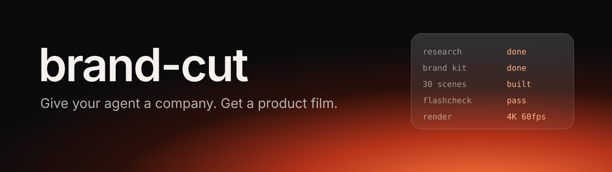
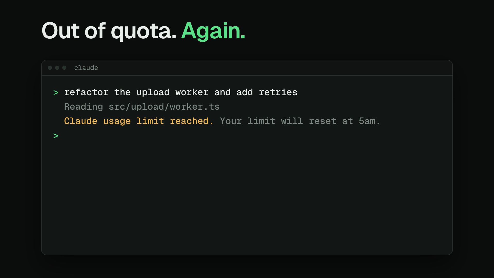
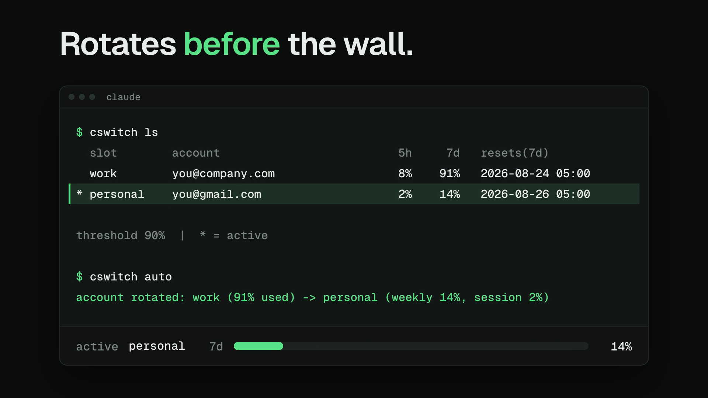
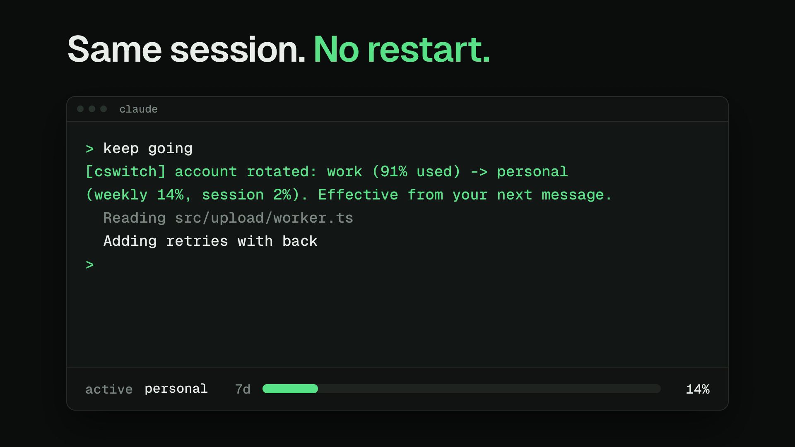
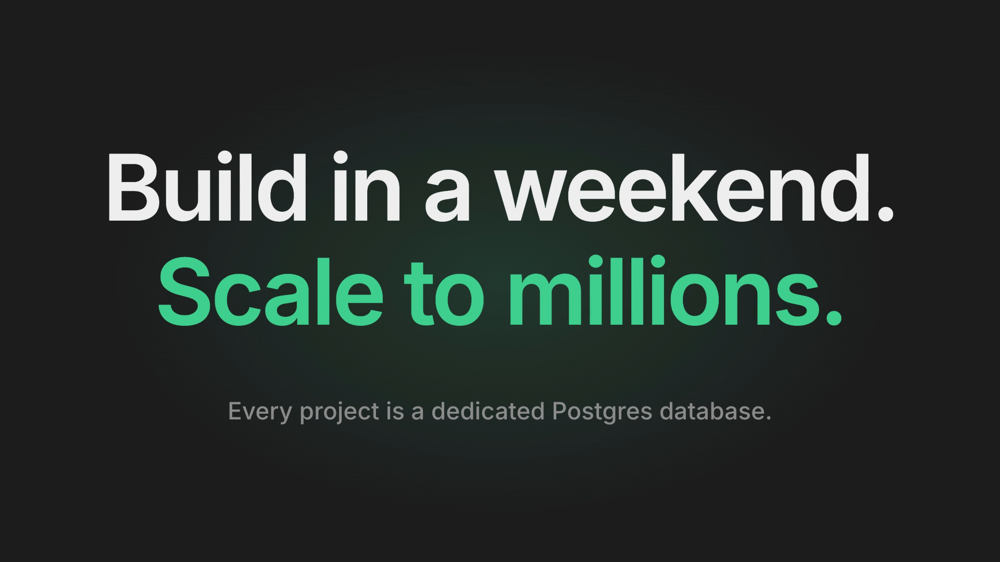
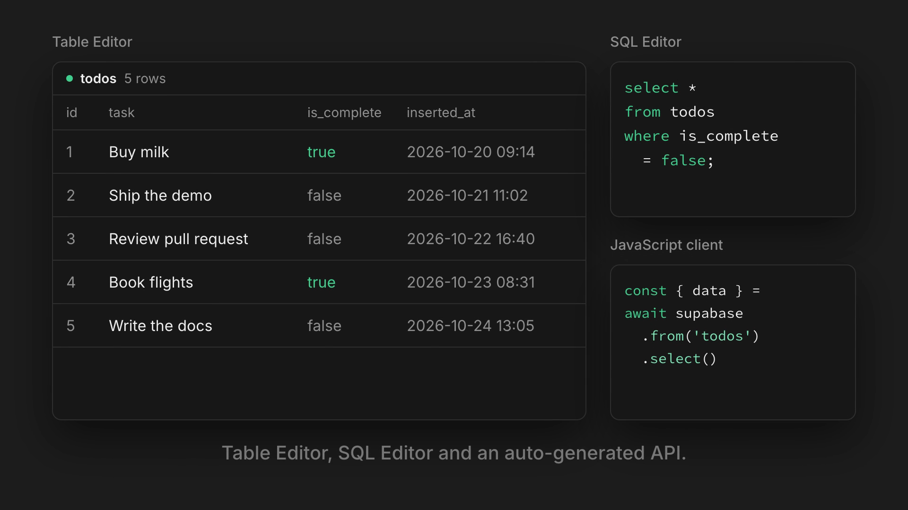
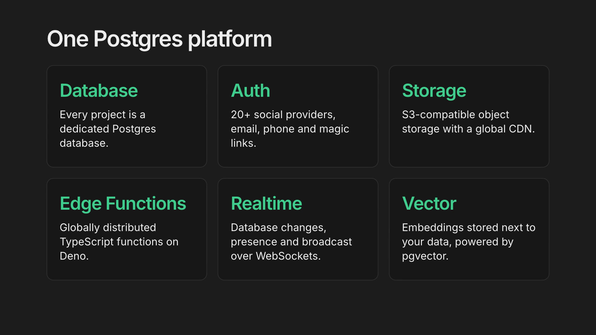
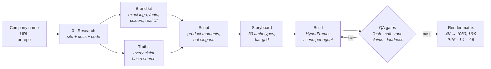

<p align="center">
  
</p>

<p align="center">
  <b>A Claude Code skill that turns a company name, a URL or a codebase into a product film.</b><br>
  It researches the product, builds a brand kit, scripts real product moments, and builds the film from 30 motion-design archetypes studied frame by frame from 18 premium reels.
</p>

<p align="center">
  <a href="#quick-start">Quick start</a> ·
  <a href="#how-it-works">How it works</a> ·
  <a href="#made-with-it">Made with it</a> ·
  <a href="#the-30-archetypes">Archetypes</a> ·
  <a href="LEARNINGS.md">Learnings</a>
</p>

---

## Made with it

Both films were made by Claude Code using this skill: it did the research, built the brand kit, wrote the SPEC, built the scenes in the archetype style and ran the flash gate. Each took about 10 minutes from one prompt. They're silent here; the pipeline adds VO, music and SFX when you ask for them.

### cswitch, from its codebase

> *"Make a 12 second launch film for github.com/sahil7992/cswitch"*

<p align="center"></p>

| | | |
|---|---|---|
|  |  |  |

The skill cloned the repo, read the README and the script to learn the real commands and their real output, and built the brand kit and every on-screen line from that. Brand kit, SPEC and notes: [`examples/cswitch/`](examples/cswitch/) · [full-quality mp4](examples/cswitch/film.mp4)

### Supabase, from just the company name

> *"Make a 12 second film for Supabase"*

<p align="center"></p>

| | | |
|---|---|---|
|  |  |  |

The skill researched supabase.com and the brand assets page for the exact logo and colours, read the product pages for facts, and recreated the real product UI. Unofficial sample, not affiliated with Supabase. [`examples/supabase/`](examples/supabase/) · [full-quality mp4](examples/supabase/film.mp4)

---

## Quick start

```sh
git clone https://github.com/sahil7992/brandcut
cd brandcut && ./install.sh        # symlinks into ~/.claude/skills/brandcut
```

Then, in Claude Code:

```
make a 15 second launch film for <company name | URL | path to repo>
```

Requirements: [Node 18+](https://nodejs.org) (HyperFrames runs through `npx`), Python 3.10+, `ffmpeg`.
Optional: `ELEVENLABS_API_KEY` for voiceover (a guard caps spend per job), and a music folder at `$MOTION_LIBRARY/music`.

More prompts that work:

```
make a 9:16 TikTok cut and a 16:9 version of the same film
study this reel and make that kind of motion for my product: <instagram url>
a 6 second logo sting for <brand>
same film, new palette: <hex> on <hex>
```

---

## How it works



**Research decides the quality.** A film written from a marketing website once made a vendor add-on the hero and invented a UI that doesn't exist. It was rejected. So stage 0 prefers the real thing:

| Input | What the skill reads | What it produces |
|---|---|---|
| **Codebase** (best) | README and docs, routes and pages, `tailwind.config` / `globals.css` / theme tokens, the logo component; it runs the app and captures real screens | exact colours and fonts, real UI captures, true feature list |
| **Website** | home, product, pricing, docs, changelog; CSS custom properties, `@font-face`, the logo SVG, the brand or press page | brand kit, tone of voice, claims with source URLs |
| **Both** | code for the facts and UI, site for positioning | the most accurate film |

Details: [`research/RESEARCH.md`](research/RESEARCH.md).

**One brand file re-themes everything.** Every archetype reads CSS variables and `window.BRAND` from `brands/<id>/brand.json` (palette with a 9-stop glow ramp, fonts, logo, UI captures, story, truths, voice). Swap the brand and the same film re-skins: `scripts/set-brand.py <film> <brand> [palette]`.

**QA is automated, not vibes.**

| Gate | What it catches |
|---|---|
| `qa/flashcheck.py` | more than 3 flashes in any second, or full-frame floods ([WCAG 2.3.1](https://www.w3.org/WAI/WCAG22/Understanding/three-flashes-or-below-threshold.html)) |
| `qa/safezone.py` | text under the TikTok / Reels UI in vertical cuts |
| `qa/claims.py` | banned words, claims the brand says never to make, all caps, emoji, uppercase CSS |
| `qa/framecheck.py` | unintended hard jumps between frames; fps and size are checked too |
| `qa/vo_diff.py` | voiceover that drifted from the script |
| loudness | mix off -14 LUFS / -1 dBTP |

---

## The 30 archetypes

Each one is a brand-agnostic HyperFrames scene (`archetypes/<name>/scene.html` + a README with timings, easing and SFX cues). They came from frame-by-frame studies of 18 motion-design reels: [`reference/studies/`](reference/studies/).

| Type and text | Product UI | Objects and space | Transitions and endings |
|---|---|---|---|
| word-blur-in | glass-slab (AI answer) | glow-field (WebGL light) | container-morph |
| tracking-collapse | chat-thread | phone-tunnel | network-lines |
| brutal-type | composer-send | object-launch | branch-tree |
| chip-marquee | notification-pile | card-burst | logo-sting |
| counter-pill | calendar-pick | card-carousel | wordmark-lockup |
| status-stack | docusign-sign | orbit-chips | icon-ring |
| checklist-fix | stripe-paid | drum-wheel | |
| list-swap-toggle | glass-tile-click | product-hero | |

```sh
python3 scripts/add-scene.py <film> word-blur-in s1 0 3.2 --vars '{"text":"Ship it today"}'
```

---

## What's in the box

```
SKILL.md            the skill Claude reads: rules, pipeline, formats, archetypes
LEARNINGS.md        every trap that got a film rejected or a render failed
research/           stage 0: company / URL / repo -> brand kit + truths + real UI
brands/demo/        a fictional brand to copy for a new one
archetypes/         30 scene templates + CONTRACT.md
reference/          PATTERNS.md (laws + structures), studies/ (18 reel breakdowns)
formats/            16:9, 9:16, 1:1, 4:5 presets + safe-zone overlays
audio/              ElevenLabs VO with a budget guard, mixer, SFX library
qa/                 flash, safe-zone, claims, frame and VO gates
scripts/            new-film, add-scene, set-brand, set-format, render-matrix, reel tools
examples/           the films above with their brand kits and specs
```

## The rules it follows

From [`LEARNINGS.md`](LEARNINGS.md), all learned the hard way:

- **Every scene is a real product moment.** Real UI, and a real AI answer when AI appears. No abstract slogans.
- **The logo is exact.** Colours come from source, never by eye.
- **Not AI-looking.** No all caps, emojis, purple gradients, sparkles, orbs, lens flares or fake UI.
- **Flash-safe.** Never more than 3 flashes a second; checked on the final file, not the draft.
- **Sharp.** Render at 4K, downscale to 1080. A native 1080 capture looks blurry.
- **Every UI action has a sound**, and nothing pumps on the beat.
- **Vertical is its own layout**, not landscape shrunk.

## Credits

Built on [HyperFrames](https://github.com/heygen-com/hyperframes) by HeyGen. Archetypes were studied from reels by @xzecreative, @anmoldoesmotion, @dija_motion, @cevox__, @tryholo.ai, @jordans.archivess, @whocoralarya_, @sandydesignstudio_, @royrayfer, @matheusmtusalem, @diegotomasfx, @coderabbitai, @saqibsouban, @youmotioncom, @kendel4204 and @drae.visuals; links in [`reference/studies/INDEX.md`](reference/studies/INDEX.md). Their frames aren't redistributed here, only notes on how the motion is built.

MIT licensed. Sample films of third-party brands are unofficial demos.
